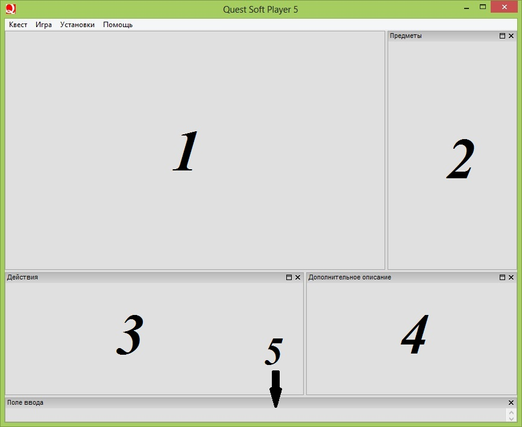
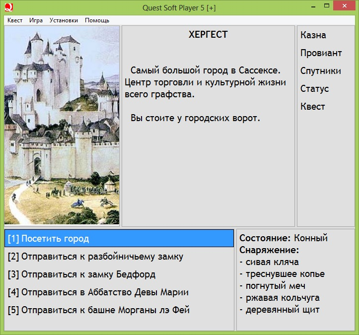
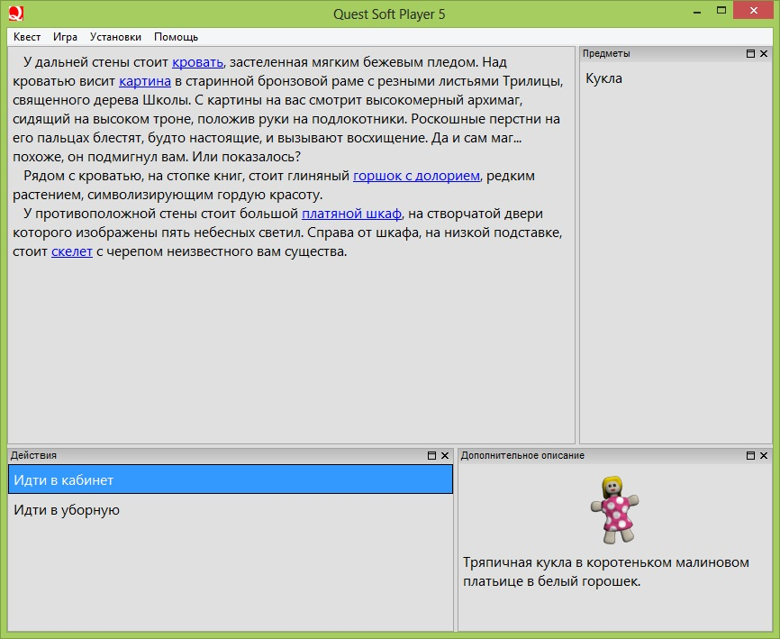
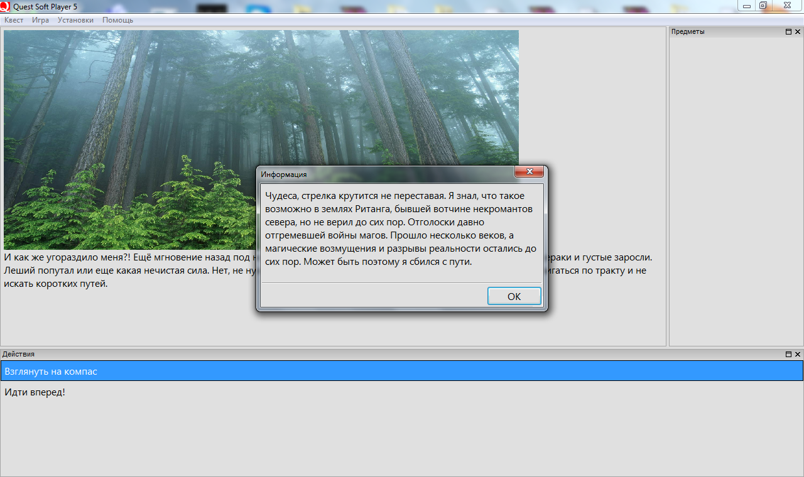
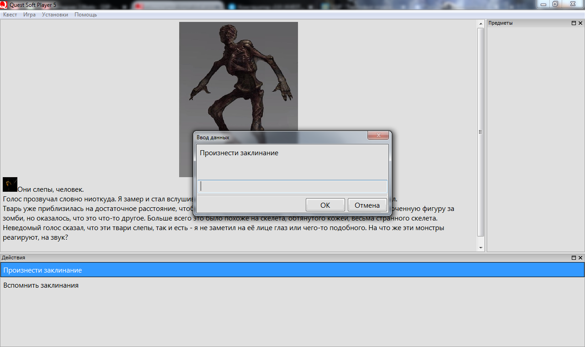

[Назад: Введение](start.mdx)

# Что такое QSP? {#chto_takoe_qsp}

Платформа **QSP** — набор программ, с помощью которых можно создавать текстовые игры и играть в них. Расшифровывается как **Quest Soft Player**.

В основном платформа **QSP** ориентирована на создание так называемых “менюшных” игр, то есть игр, где управление осуществляется при помощи нажатия различных кнопок и пунктов меню. Однако на **QSP** можно писать и парсерные игры — игры, управление которыми осуществляется с помощью вводимых в строку ввода команд.

Подробная Справка, простой синтаксис, множество примеров и отзывчивое сообщество позволят Вам освоить QSP максимально быстро.

Стандартный классический плеер **QSP** воспроизводит файлы игр с расширением “`.qsp`”. Эти файлы можно создавать в редакторе **[Quest Generator](utility-i-sredstva-razrabotki/help_qgen.mdx)**, а так же конвертируя обычные текстовые файлы, написанные в специальном формате, с помощью утилиты **[TXT2GAM](utility-i-sredstva-razrabotki/help_txt2gam.mdx)**.

Большинство статей ориентированы на использование классического плеера **QSP** версии 5.9.4 и редактора игр **Quest Generator** версии 4.0.0 Beta. Отдельные разделы посвящены новому плееру **[qSpider](nyuansy-napisaniya-igr-pod-raznye-pleery/help_qspider/help_qspider.mdx)** и написанию игр в текстовом редакторе с использованием утилиты **[TXT2GAM](utility-i-sredstva-razrabotki/help_txt2gam.mdx)**. Большой разницы в написании игр для разных плееров и в разных редакторах нет; о существенных отличиях будет упомянуто в соответствующих статьях.

## Возможности QSP {#vozmozhnosti_qsp}

Базовый функционал QSP[1)](#fn__1):

1. Два окна для вывода текста: основное и дополнительное
2. Окно Действий
3. Окно Предметов (Инвентаря)
4. Строка ввода (для реализации парсерных игр и отладки)
5. Всплывающие сообщения пользователю, картинки
6. Всплывающее окно для ввода текста пользователем
7. Возможность создания всплывающего меню для предметов (и не только)
8. Проигрывание музыки и звуков
9. Поддержка HTML
10. Возможность сохранения и загрузки игрового прогресса
11. Встроенный язык программирования со следующими особенностями:
  - Целочисленные и строковые переменные, кортежи
  - Поддержка массивов
  - Продвинутая обработка строк и массивов (поддержка регулярных выражений)
  - Условные выражения
  - Циклы
  - Метки и переходы по меткам
  - Возможность привязки к реальному времени
  - Возможность выполнения определенных действий при каждом переходе на новую локацию, при создании и удалении предметов, при выборе пункта меню и других **событиях**
  - Возможность выносить часть кода в подключаемые файлы

## Стандартный экран QSP {#standartnyj_ehkran_qsp}

На представленном ниже изображении вы можете видеть пять основных областей классического плеера **QSP**, которые так же могут называться окнами.

1. Окно основного описания
2. Окно предметов (инвентаря)
3. Окно действий
4. Окно дополнительного описания
5. Поле ввода, или Строка ввода

Интерфейс **QSP** отличается гибкостью. Все окна, кроме основного окна описания могут отключаться.

Ниже для примера приведены скриншоты игр “Куртуазная баллада” и “Мировое сознание, 13 уровень” (картинки кликабельны).

 

## Примеры всплывающих окон и меню {#primery_vsplyvajuschix_okon_i_menju}

Примеры использования вывода сообщения в диалоговом окне посредством [MSG](vyvod-teksta/help_msgbox.mdx), и ввода текста в диалоговом окне игроком посредством [INPUT](rasshirennye-vozmozhnosti/help_inputs.mdx)

 

!!! Здесь должны быть → Скриншот VIEW; Три скриншота MENU (предмет, действие, ссылка)

## Версии плеера QSP {#versii_pleera_qsp}

Существуют различные версии плееров для разных операционных систем, в том числе и для устройств на Андроид. Вы можете скачать подходящий плеер [здесь](https://qsp.org/index.php?option=com_content&view=article&id=64&Itemid=56).

## Исходный код {#isxodnyj_kod}

[Исходный код библиотеки интерпретатора QSP](https://github.com/QSPFoundation/qsp)

[Вперёд: Локации](help_locations.mdx)

[1)](#fnt__1) 
без дополнительных ухищрений, с ухищрениями - гораздо больше =)
