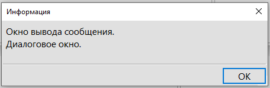

[Назад: Окно дополнительного описания](help_stat.mdx)

# Окно сообщений {#okno_soobschenij}

**Окно сообщений** — это всплывающее окошко, в котором вы можете вывести своё сообщение для игрока. Данное окошко необходимо исключительно для информирования, вы не сможете получить из него никаких данных, узнать нажал ли игрок на кнопку “OK” или на крестик в углу. Никакие варианты для этого окошка не предусмотрены.

При выводе на экран **Окна сообщения** выполнение всего остального кода игры приостанавливается, пока игрок не нажмёт кнопку “OK”, или не закроет **Окно сообщения**.



## Команда для вывода Окна сообщения {#komanda_dlja_vyvoda_okna_soobschenija}

`MSG [$текст]` - вывод сообщения `[$текст]` в диалоговом окне.

## Примеры {#primery}

```qsp
! простой вывод сообщения.
msg 'Много спелых груш.'
! получим окно с сообщением 'Много спелых груш'
```

```qsp
! Пример сообщения в действии ACT.
act 'Поесть груш':
  msg 'Ммм груши очень вкусные.'
end
! Получим вывод сообщения при клике по действию "Поесть груш"
```

```qsp
!Пример с условием.
if hlebgotov = 1:
  msg 'Похоже хлеб уже готов.'
end
! Получаем вывод сообщения когда условие hlebgotov = 1 выполняется
```

[Вперёд: Действия](../help_acts.mdx)
